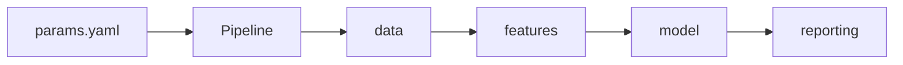
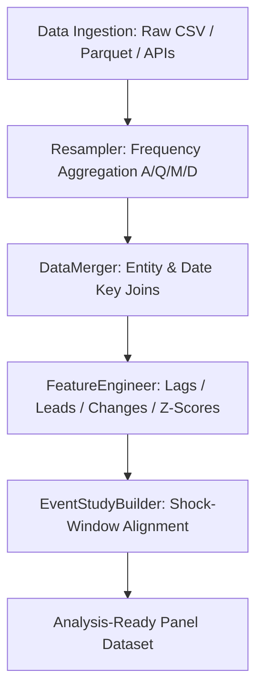
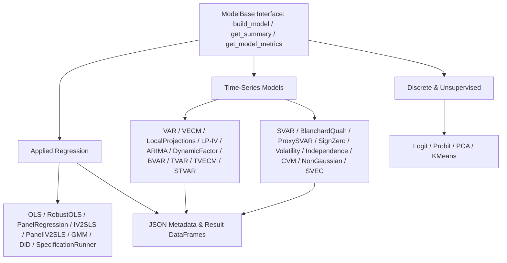
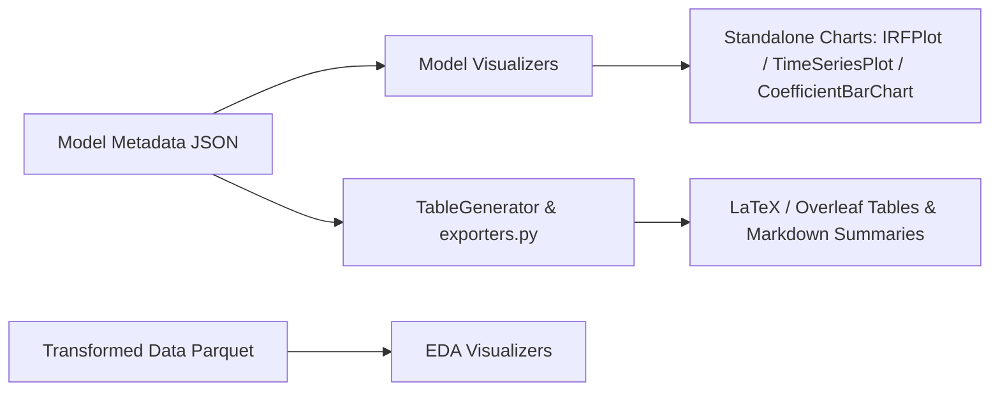

# System Architecture & Repository Structure

`stats-transformer` is a configuration-driven Python library designed for the complete empirical workflow: frequency-aware data preparation, feature construction, econometric estimation, diagnostics, and publication-ready reporting outputs. It acts as a reproducible workflow layer built upon foundational Python scientific computing packages (`numpy`, `pandas`, `statsmodels`, `linearmodels`, `scipy`).

---

## 1. Workflow Contract

For YAML-driven execution, the `Pipeline` class coordinates sequential execution stages:



- **Pipeline Stages**:
  - `data`: Ingests, resamples to a common frequency, and merges datasets (`DataMerger`).
  - `features`: Applies `FeatureEngineer` transformations within entity boundaries.
  - `model`: Fits configured estimators and outputs structured JSON metadata and diagnostics.
  - `reporting`: Renders configured plots, tables, and model metadata from transformed data and model results.
  - `eda`: Generates exploratory data analysis charts.
- **Stage Execution**: `Pipeline.run(stage=...)` accepts `data`, `features`, `model`, `reporting`, `eda`, or `None` for full sequential execution. Dedicated stage methods (`run_data()`, `run_features()`, `run_model()`, `run_reporting()`, `run_eda()`) can also be called directly. Legacy names (`resample`, `regression`, `visualization`) remain supported as deprecated aliases.
- **Persisted Artifacts**: Every stage persists inspectable artifacts (Parquet, CSV, JSON, figures) enabling modular inspection and caching.

---

## 2. Repository File Structure & Boundaries

The repository follows a Cookiecutter Data Science-style separation between reusable library code, empirical inputs, executable examples, tests, configurations, and generated outputs.

```text
.
├── .agents/                       # Project instructions and agent skills
├── data/
│   ├── examples/                  # Bundled and validation example datasets
│   ├── final/                     # Engineered analysis-ready panels (gitignored)
│   ├── pipeline/                  # Per-run pipeline artifacts (<config>/<timestamp>/ run folders; gitignored)
│   ├── raw/                       # Source raw datasets
│   └── temp/                      # Disposable local data (gitignored)
├── docs/
│   ├── library/                   # Architecture, model catalog, data guide, citations
│   ├── validation/                # Software benchmarks and test suite guides
│   ├── overview.md                # Central documentation hub
│   └── roadmap.md                 # Future model extensions roadmap
├── models/                        # Serialized model artifacts when produced
├── notebooks/                     # Exploratory interactive demonstrations
├── references/
│   ├── configs/                   # YAML specifications (params.yaml)
│   └── dictionaries/              # Constant mapping files
├── reports/
│   ├── figures/                   # Generated visual outputs
│   ├── tables/                    # Generated LaTeX and markdown tables
│   └── visualizations/            # EDA and model visualizations
├── src/
│   ├── examples/                  # Executable demonstrations and benchmark scripts
│   ├── stats_transformer/         # Installable Python package
│   └── temp/                      # Disposable development scripts
└── tests/
    ├── data/                      # Stable test fixtures
    ├── external_benchmarks/       # Reference outputs and recorders (MATLAB, R, Stata)
    ├── integration/               # Multi-language integration tests (R, Stata)
    ├── test_configs/              # Every YAML config under references/configs/
    ├── test_data/                 # Packaged data, DataMerger, panel builder
    ├── test_docs/                 # Doc/code contracts and paper application artefacts
    ├── test_examples/             # Example registry and academic replications
    ├── test_external_parity/      # Recorded cross-language parity checks
    ├── test_feature_engineering/  # FeatureEngineer transformations and resampling
    ├── test_models/               # Regression, discrete, and time-series models
    ├── test_package/              # Packaging and public API exports
    ├── test_pipeline/             # Pipeline orchestration, stages, and output paths
    ├── test_reporting/            # Charts, tables, and visualizers
    ├── test_utils/                # Configuration and utility helpers
    └── conftest.py                # Shared fixtures
```

---

## 3. Package Architecture & Core Components

```text
src/stats_transformer/
├── __init__.py                    # Public API re-exports
├── pipeline.py                    # YAML-driven orchestration
├── data/                          # Packaged datasets and example loader
├── featurization/
|   ├── base.py                    # Base model for feature engineering
│   ├── feature_engineering.py     # Transformations and resampling
│   ├── data_merger.py             # Multi-source panel joins
│   └── event_study.py             # Event-study window construction
├── models/
│   ├── base.py                    # Common ModelBase contract
│   ├── registry.py                # Model registry and YAML dispatcher
│   ├── regression/                # OLS, Robust OLS, Panel OLS, IV, Panel IV, GMM, DiD, SpecRunner
│   ├── timeseries/                # VAR, VECM, SVAR, LP, ARIMA, Dynamic Factor, BVAR, Nonlinear, Diagnostics
│   ├── discrete/                  # Logit, Probit
│   └── unsupervised/              # PCA, KMeans
├── reporting/                     # Charts, tables, exporters, and model visualizers
│   ├── charts/                    # Reusable chart components (IRFPlot, TimeSeriesPlot, etc.)
│   ├── eda/                       # Exploratory visualizers
│   ├── models/                    # Model and regression visualizers
│   ├── tables/                    # TableGenerator
│   ├── timeseries/                # Time-series report adapters and reporter
│   ├── formatters/                # Significance stars and style application
│   ├── defaults/                  # Styles, palettes, labels
│   └── exporters.py               # Metrics persistence
├── utils/                         # Configuration and shared utilities
```

---

## 4. Component Details & Subsystem Diagrams

### 4.1 Data Ingestion & Feature Engineering Flow



- **`FeatureEngineer`**: Applies transformations within entity boundaries across annual (A), quarterly (Q), monthly (M), and daily (D) frequencies. Operations include log levels, changes, percentage changes, lags, leads, rolling means, and z-scores.
- **`DataMerger`**: Executes panel joins across multiple data sources using explicit entity and date keys.
- **`EventStudyBuilder`**: Constructs normalized event-window panels around shock dates.

---

### 4.2 Econometric Estimators & Base Hierarchy



- **Unified Base Contract (`ModelBase`)**: Every model implements the `ModelBase` abstract contract (`build_model`, `get_summary`, `get_model_metrics`); `fit` and the JSON metadata method `get_model_metadata` are provided by the base class.
- **Normalized Outputs**: All estimators return normalized DataFrames and structured JSON metadata containing coefficients, standard errors, $t$-statistics, $p$-values, covariance matrices, and model diagnostic metrics.
- **Complete Reference**: For full mathematical specifications, access aliases, and benchmark comparisons for all 32 implemented model classes, see the [Implemented Models Catalog](models.md).

---

### 4.3 Visualization & Reporting Flow



- **Modular Chart Components (`src/stats_transformer/reporting/charts/`)**: Standalone, composable plotting classes (`IRFPlot`, `TimeSeriesPlot`, `CoefficientBarChart`, `FacetedTimeSeries`, `BinnedScatterPlot`, `CorrelationHeatmap`).
- **Reporting & Exporters (`src/stats_transformer/reporting/`)**: Publication-ready LaTeX and Markdown table generation via `TableGenerator` and metrics persistence via `exporters.py`.

---

## 5. Configuration & Reproducibility Boundaries

- `references/configs/`: The control center for reproducible specifications. Configurations select raw data, transformation settings, model choices, and output directories.
- `reports/`: Stores figures and tables written to `reporting.output_dir` (default `reports/visualizations`) and any explicitly configured summary/report paths.
- Source datasets remain unmodified. Each full pipeline run, and each single-stage run, writes its artifacts into a per-run folder under the output root (`output.root`, default `data/pipeline`), resolved relative to the CWD:

```text
<output.root>/<config_stem>/<YYYYMMDD_HHMMSS>/
├── 01_data/merged.parquet        # copy of the merged data (always written); the canonical chaining copy
│   │                             # lives at data.merge.output_path (or the data/pipeline default, as before)
│   └── raw/<dataset>.parquet     # each loaded source, pre-resample, named after the config's dataset key
├── 02_features/features.parquet  # always written; keeps dtypes
├── 03_model/model_summary.json   # written when the model stage runs
│   ├── model_data.parquet        # the exact data the model was fitted on (df_clean, used columns only)
│   └── model.joblib              # joblib dump of the fitted model (skipped with a warning if it cannot be pickled)
└── manifest.json                 # config copy + sha256, input file checksums, git SHA (when available),
                                  # package version, stages run, UTC timestamps, written files, artifact shapes
```

- Explicit output paths (`data.merge.output_path`, `data.featurization.output_path`, `model.summary_output_path`, `reporting.output_dir`) are still written exactly as configured; the run folder is an addition, not a replacement. Single-stage runs chain through these explicit paths; a run folder does not replace them.

---

## 6. Related Documentation

- [Documentation overview](../overview.md)
- [Implemented models catalog](models.md)
- [Data directory guide](data.md)
- [Academic citations](citations.md)
- [Cross-language software benchmarks](../validation/benchmarks.md)
- [Testing suite](../validation/testing_suite.md)
- [Future model roadmap](../roadmap.md)
